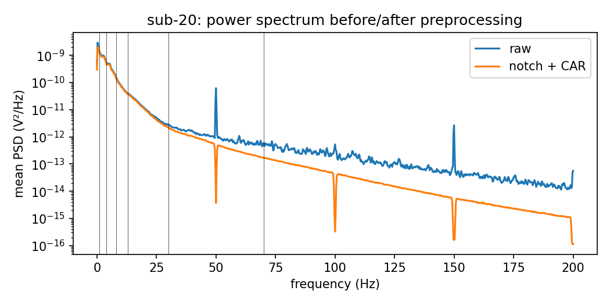
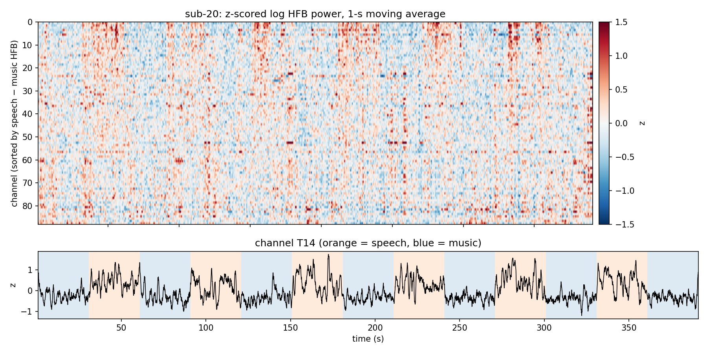
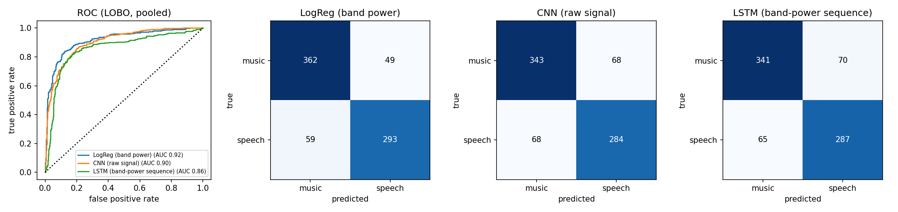
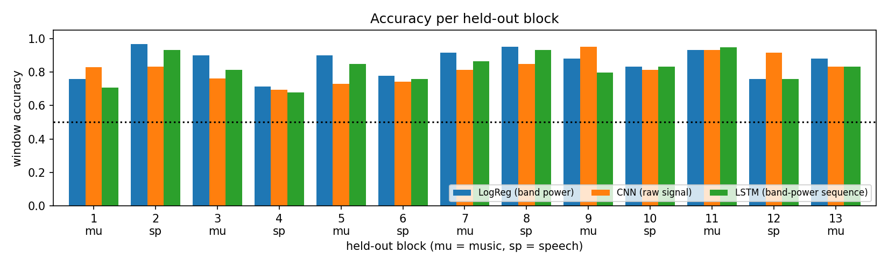
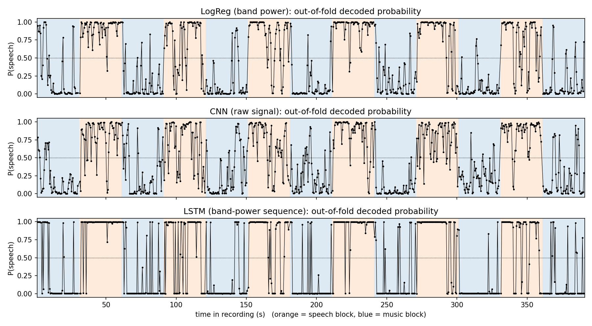
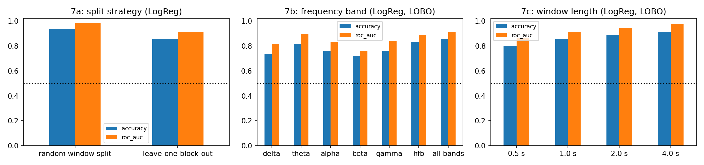
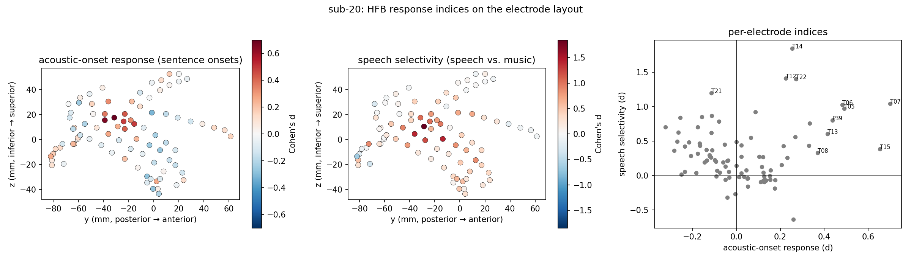
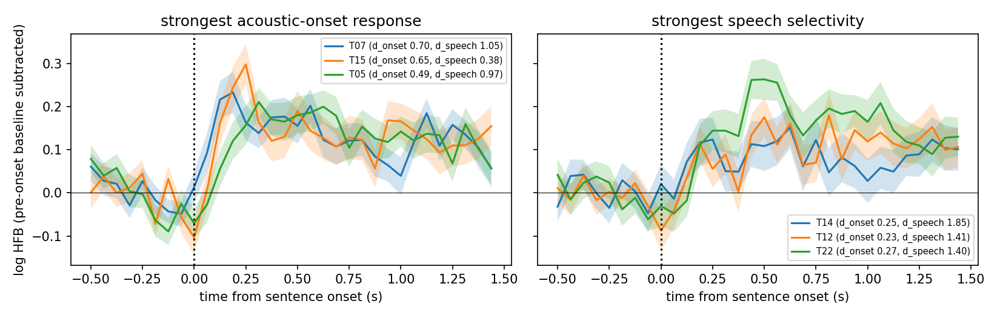

# Decoding speech vs. non-speech from intracranial EEG

**ES 673 NeuroAI – Take-home assignment 5** · Durgesh Mishra · November 2026

## 1. Task and data

In this assignment I built a decoder. It takes a short piece of intracranial EEG (iEEG) and predicts whether the
person was hearing **speech** or **non-speech** at that moment. I used the OpenNeuro dataset ds003688
(Berezutskaya et al., 2022). In this dataset, epilepsy patients with electrodes on the brain watched a 6.5-minute
children's film. The sound of the film switches every 30 seconds between dialogue (speech) and music (non-speech).
There are 7 music blocks and 6 speech blocks. The block times are given in `events.tsv`.

I used participant **sub-20** (`ses-iemu`, `task-film`, `acq-clinical`, `run-1`). This participant has 96 ECoG contacts, of which 88 are good (8 are marked bad in `channels.tsv`). The signal is sampled at 512 Hz. All electrodes
are on the left side of the brain, and 32 of them form a grid over the temporal lobe. Before choosing, I tested sixpa rticipants with a simple logistic regression decoder, sub-20 gave the clearest difference between speech and music
in high-frequency power, so I used this one. I come back to this choice in the limitations.

## 2. Methods

**Loading and preprocessing (MNE).** I loaded the BrainVision file with MNE-Python (`read_raw_brainvision`). I took
the channel types and the list of bad channels from `channels.tsv`. Then I removed the 50 Hz power-line noise and its
harmonics (100, 150, 200 Hz) with a notch filter (ref site: https://www.rfpage.com/what-is-notch-filter/), and re-referenced the 88 good channels to their common average
(Fig. 1).

*Figure 1. Average power spectrum of all channels before and after preprocessing. The notch filter removes the 50-Hz line and its harmonics. The common average reference removes noise that is shared by all contacts.*

**Features.** I split the signal into six frequency bands: delta (1–4 Hz), theta (4–8), alpha (8–13), beta (13–30),
gamma (30–70) and the high-frequency band HFB (70–170 Hz). For each band and each channel I computed the envelope
(the power over time) with a band-pass filter and the Hilbert transform. I took the log of the envelope and averaged
it in bins of 62.5 ms (16 per second). The result is one array of size channels × time × bands. From this array I get
two kinds of features: the mean over a window (the log band power, a spectral feature) and the 16-step time course
inside a window (a temporal feature).

**Alignment and windows.** I cut each 30-s block into 1-s windows with a step of 0.5 s. This gives 763 windows
(352 speech, 411 music). Each window remembers which block it comes from. Figure 2 checks that the labels line up
with the signal: in the best temporal electrode (T14), HFB power goes up in every speech block and down in every
music block.

*Figure 2. Top: z-scored log HFB power of all 88 channels during the film (1-s moving average), sorted by their speech−music difference. Bottom: channel T14. Orange = speech blocks, blue = music blocks.*

**Train/test split.** Windows that are close in time overlap and look very similar. If I split the windows at
random, the training set would contain near-copies of the test windows, and the score would be too high. So I used
**leave-one-block-out (LOBO)** cross-validation. Each of the 13 blocks is held out once, and the decoder is trained
on the other 12 blocks (which always contain both classes). In this way every window is predicted by a model that
never saw its block. I pool these predictions over all blocks and compute all metrics on them. The feature scaling
uses the mean and standard deviation of the training blocks only.

**Decoders.**

* *LogReg*: logistic regression with L2 penalty (C = 0.1) on the 88 × 6 = 528 log band-power values.
* *CNN*: a 1-D convolutional network on the raw preprocessed signal (88 channels × 512 samples). It has three
  Conv1d–BatchNorm–ReLU stages (32 filters, kernel sizes 15/15/7, max-pooling by 4 after the first two), global
  average pooling, dropout 0.5 and one linear output unit.
* *LSTM*: one LSTM layer (64 hidden units) over the 16-step sequence of the 528 band-power values, then dropout 0.5
  and one linear output unit on the last hidden state.

I trained both networks with AdamW (learning rate 10⁻³, weight decay 10⁻²), binary cross-entropy loss, batch size 64,
30 epochs and a fixed random seed. I fixed these settings before training and did not tune them on the held-out
blocks.

## 3. Results

| decoder (LOBO, 763 windows) | accuracy | balanced acc. | F1 | ROC-AUC |
|---|---|---|---|---|
| LogReg (band power) | **0.858** | 0.857 | 0.844 | **0.916** |
| CNN (raw signal) | 0.822 | 0.821 | 0.807 | 0.903 |
| LSTM (band-power sequence) | 0.823 | 0.822 | 0.810 | 0.858 |

All three decoders are well above chance. Chance is 0.5, or 0.54 if the model always says "music". The simplest
model, logistic regression on band power, is also the best. The CNN comes close, even though it has to learn its own
frequency filters from 1-s pieces of raw signal. The LSTM has the same accuracy as the CNN, but its probabilities are
almost always close to 0 or 1 (Fig. 5). It is over-confident, and so its ranking of windows (AUC 0.86) is worse.

*Figure 3. ROC curves of the pooled predictions and confusion matrices for the three decoders.*

*Figure 4. Accuracy for each held-out block. Every block and every model is above chance. The hardest blocks are speech blocks 4 and 6.*

*Figure 5. Decoded probability of speech across the film (pooled predictions). The probability follows the blocks. Most errors are short jumps inside music blocks and short dips inside speech blocks. These make sense, because the dialogue has pauses and the music blocks contain other sounds.*

### Extra experiments (logistic regression)

| experiment | setting | accuracy | ROC-AUC |
|---|---|---|---|
| split | random 5-fold split of windows | 0.937 | 0.985 |
|  | leave-one-block-out | 0.858 | 0.916 |
| frequency band | delta (1–4 Hz) | 0.739 | 0.815 |
|  | theta (4–8 Hz) | 0.813 | 0.896 |
|  | alpha (8–13 Hz) | 0.759 | 0.836 |
|  | beta (13–30 Hz) | 0.718 | 0.761 |
|  | gamma (30–70 Hz) | 0.763 | 0.841 |
|  | HFB (70–170 Hz) | **0.835** | 0.891 |
|  | all six bands | 0.858 | 0.916 |
| window length | 0.5 s | 0.804 | 0.866 |
|  | 1 s | 0.858 | 0.916 |
|  | 2 s | 0.887 | 0.945 |
|  | 4 s | 0.910 | 0.975 |

*Figure 6. Effect of the split, the frequency band and the window length.*

* **Split.** The same model gets 94 % with a random split of windows but 86 % with the block-wise split. The 8-point
  gap is leakage from neighbouring windows, not real decoding skill. Only the block-wise number tells us how the
  decoder would do on a new part of the film.
* **Frequency bands.** The HFB (70–170 Hz) is the best single band (83.5 %). This fits with HFB power being a measure
  of local neural firing in auditory cortex. Theta (4–8 Hz) is second best, which fits with the brain following the
  syllable rhythm of speech. Using all bands together adds another 2 points.
* **Window length.** Accuracy goes up with window length, from 80 % at 0.5 s to 91 % at 4 s. Longer windows average
  out pauses in the speech and the fast ups and downs of HFB power. The cost is that the decoder becomes slower to
  react.

## 4. Extra credit: sound responses vs. speech responses across electrodes

The question here is: do all electrodes respond to speech in the same way, or do some respond to sound in general
and others to speech in particular? To answer this, I gave every electrode two scores. Both come from its
high-frequency (HFB) power.

* **Speech score.** How much higher is HFB power during speech blocks than during music blocks? I measure this with
  Cohen's *d*, which is the difference between the two means divided by the spread. A positive score means more
  power during speech.
* **Onset score.** How much does HFB power jump right after a sentence begins? The film has 67 sentences, and their
  start times are listed in the dataset file `sound_annotation_sentences.tsv`. For each sentence I compare the power
  in the 0.05–0.35 s after the start with the power in the 0.5 s before it. The score is again a Cohen's *d*. A
  sentence that begins after a pause is a sudden change in the sound. So a high onset score means the electrode
  reacts quickly to a change in sound. This is not the same as preferring speech.

*Figure 7. Left and middle: the onset score and the speech score drawn at the electrode positions (`electrodes.tsv`, side view of the left hemisphere). Right: the two scores plotted against each other. Contacts in the top 8 % of either score are labelled.*

*Figure 8. HFB power around sentence starts (mean ± s.e.m. over 67 sentences, baseline removed). Left: the three electrodes with the highest onset score. Right: the three electrodes with the highest speech score.*

What I found (Fig. 7):

* The speech score is high mainly on the temporal grid. Its mean there is 0.60, and the highest value is 1.85 at
  contact T14. The other strips (frontal, parietal, parieto-occipital and sub-temporal) stay at 0.38 or below.
  21 contacts have a score above 0.5. Only two contacts prefer music (score below −0.3).
* The onset score picks out a different, smaller group: T07, T15, T05, T06 and P39 (scores 0.44–0.70). These
  contacts sit in the upper, back part of the grid. The contacts with the highest speech score (T12, T22 and T21)
  sit about 10–15 mm lower, in the middle of the superior temporal gyrus.
* The two scores are only weakly related (r = 0.17). An electrode that reacts strongly to sound changes is not
  necessarily one that prefers speech, and the other way round.
* Figure 8 shows the difference in time. The onset electrodes show a sharp peak 150–250 ms after the sentence starts
  and then partly go back down. The speech electrodes rise more slowly and stay up while the sentence goes on.

This matches what Hamilton et al. (2018) found in the human superior temporal gyrus: a back part with short "onset"
responses and a front part with longer "sustained" responses. In this participant, the upper back contacts work like
detectors of sound changes, and the lower front contacts follow the speech while it goes on.

## 5. Interpretation and limitations

* **What is decoded.** With leave-one-block-out validation, a 1-s window of iEEG can be labelled as speech or music
  with about 86 % accuracy (AUC 0.92). Most of the information is in the high-frequency power of a few temporal-lobe
  contacts. This is what we expect from auditory cortex, so the result is easy to interpret and is not an artefact.
* **Only 13 blocks.** The 763 windows come from only 13 separate 30-s blocks, so the real sample size is small. The
  per-block accuracies (Fig. 4) range from about 0.7 to 0.97. More data would be needed to tell the deep models
  apart. Here the simplest model wins, which is common for small iEEG datasets.
* **Speech vs. music is a coarse contrast.** The two classes differ in sound, in language content and in what is on
  the screen. The film also runs without breaks: the dialogue has pauses and the music blocks have other sounds. So
  the decoder detects "speech-like sound is present", not language processing as such. Some "errors" in Fig. 5 may
  even be right about the actual soundtrack.
* **Participant selection.** I picked sub-20 because it had the strongest contrast of the six participants I
  screened. The reported accuracy is therefore higher than what a random participant would give, since their
  electrodes may not cover auditory cortex.
* **No hyper-parameter search.** I used fixed, reasonable settings.

## References

* Berezutskaya J. et al. (2022). Open multimodal iEEG-fMRI dataset from naturalistic stimulation with a short
  audiovisual film. *Scientific Data* 9:91. OpenNeuro ds003688 v1.0.7.
* Hamilton L.S., Edwards E., Chang E.F. (2018). A spatial map of onset and sustained responses to speech in the human
  superior temporal gyrus. *Current Biology* 28:1860–1871.
* Gramfort A. et al. (2013). MEG and EEG data analysis with MNE-Python. *Frontiers in Neuroscience* 7:267.
